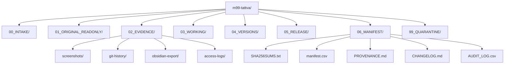
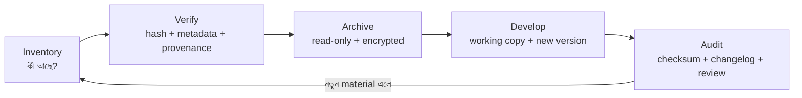

# M99 Research Archive 2023–2026 — “তত্ত্ব” প্রকল্প গ্রহণ ও সংরক্ষণ টেমপ্লেট

## নির্বাহী সারাংশ

এই নথির scope ইচ্ছাকৃতভাবে সংকীর্ণ: **শুধু M99-এর “তত্ত্ব” (Theory) বিষয়ক গবেষণা উপকরণ**। ONE SKY ENGINE, ZERO Civilization Engine, Universe Miracle System, Jagaran, SAHAYAK বা অন্য M99 প্রকল্প এখানে মূল content হিসেবে মেশানো হবে না; কোনো উপকরণ “তত্ত্ব”-এর provenance বোঝাতে প্রয়োজন হলে শুধু cross-reference হিসেবে উল্লেখ করা যাবে।

তোমার বিদ্যমান **M99 Master Index** ইতিমধ্যেই provenance, historical-discovery record, conflict preservation, original-source preservation, semantic versioning, privacy review এবং Git-এ API key/password/token না রাখার নীতি নির্ধারণ করেছে। ফলে নতুন intake template-টি সেই ভিত্তি ভেঙে নতুন ব্যবস্থা বানানোর বদলে সেটিকেই আরও নির্দিষ্ট archival workflow-এ রূপ দিচ্ছে। fileciteturn0file5 M99 Identity Map-এও “আজ্ঞান তত্ত্ব” এবং সংশ্লিষ্ট archive-কে বৃহত্তর M99 filing structure-এর অংশ হিসেবে রাখা হয়েছে; তাই theory materials-কে অন্য production project থেকে আলাদা রাখা M99-এর বিদ্যমান নথি-দর্শনের সঙ্গে সামঞ্জস্যপূর্ণ। fileciteturn0file6

সংরক্ষণের মূল নীতি হবে:

**Original → Inventory → SHA-256 → Provenance → Read-only Archive → Working Copy → Version → Audit**

এটি digital-preservation practice-এর সঙ্গেও সামঞ্জস্যপূর্ণ: Library of Congress fixity-কে একটি digital object দুই সময়ের মধ্যে বদলেছে কি না বোঝার বৈশিষ্ট্য হিসেবে সংজ্ঞায়িত করে এবং SHA-256-সহ checksum ব্যবহারের কথা বলে; NARA permanent digital records-এর জন্য fixity, tracked actions, manifests এবং নিয়মিত audit ব্যবহারের কথা বলে। citeturn5search1turn5search2turn5search3

**গুরুত্বপূর্ণ সীমা:** SHA-256 কোনো নথির লেখক, আইনগত মালিক বা “কে তৈরি করেছে” তা প্রমাণ করে না। এটি মূলত নির্দিষ্ট byte-sequence একই আছে কি না যাচাই করতে সাহায্য করে। Ownership, provenance, Git history, timestamps, source files ও contributor records আলাদাভাবে রাখতে হবে। citeturn5search1turn5search4

এই গবেষণায় কোনো বাহ্যিক account, GitHub repository, Obsidian vault বা cloud workspace-এ প্রবেশ করা হয়নি। **ব্যবহারকারী যে files/exports সরবরাহ করবেন, শুধু সেগুলোই intake evidence হবে।**

**ডাউনলোডযোগ্য Markdown:** [M99_Tattva_Project_Intake_Template_bn.md](sandbox:/mnt/data/M99_Tattva_Project_Intake_Template_bn.md)

## পরিধি, উৎস ও প্রমাণনীতি

এই template-এ `তত্ত্ব` বলতে **তুমি যে নির্দিষ্ট M99 Theory project নিবন্ধন করবে সেটিই** বোঝাবে। “তত্ত্ব”-এর সঙ্গে অন্য M99 project-এর সম্পর্ক থাকলেও archive-এর ভেতরে content boundary বজায় থাকবে। এটি বিশেষভাবে গুরুত্বপূর্ণ, কারণ তোমার Master Index M99-কে একটি continuous namespace হিসেবে ধরে, কিন্তু একই সঙ্গে historical records ও version lineage সংরক্ষণ করার নির্দেশও দেয়। fileciteturn0file5

প্রস্তাবিত evidence priority হবে:

1. **User-provided original file** — মূল `.md`, `.txt`, `.pdf`, `.docx`, `.pages`, source bundle।
2. **User-exported Git history** — commit history, file history, diff, tags/branches সম্পর্কিত export।
3. **User-exported Obsidian vault** — original directory structure, Markdown এবং attachments।
4. **Original screenshots** — UI, file listing, history, timestamps, project state।
5. **Access/log export** — ব্যবহারকারী নিজে account থেকে export করে দিলে।
6. **Derived copy** — conversion, OCR, summary, PDF export, edited Markdown।
7. **Recollection/narrative note** — context হিসেবে রাখা যাবে, original artifact-এর বিকল্প হিসেবে নয়।

Library of Congress provenance-কে chain of custody এবং content তৈরির পর থেকে পরিবর্তনের record হিসেবে বিবেচনা করে; fixity, context ও provenance-কে আলাদা preservation metadata হিসেবে রাখা দীর্ঘমেয়াদি archive-এর জন্য উপযোগী। citeturn5search6

প্রতিটি asset-এর status স্পষ্ট রাখবে:

`ORIGINAL` → user-provided source  
`EVIDENCE` → screenshot/log/history  
`DERIVED` → original থেকে তৈরি copy  
`WORKING` → development copy  
`RELEASE` → অনুমোদিত version  
`THIRD_PARTY` → বাইরের code/asset  
`QUARANTINE` → classification অসম্পূর্ণ

এখানে **“verify” মানে theory সত্য কি মিথ্যা যাচাই করা নয়**। এই archive-এর verify ধাপের অর্থ: file identity, checksum, provenance field, filename, timestamp এবং version relationship মিলিয়ে দেখা।

প্রতিটি evidence record-এর ন্যূনতম provenance block:

```yaml
provenance:
  evidence_id: "E-2026-10-26-001"
  project: "M99 তত্ত্ব"
  source_kind: "ORIGINAL | GIT_EXPORT | OBSIDIAN_EXPORT | SCREENSHOT | LOG | DERIVED"
  original_filename: ""
  original_location_reported: ""
  provided_by: ""
  received_at: ""
  observed_at: ""
  transformations: "NONE"
  sha256: ""
  related_assets: []
  notes: ""
```

Master Index-এর নিজস্ব historical-discovery policy-ও newly discovered old material-এর original date, original location, source document, change history ও current location নথিবদ্ধ করতে বলে। fileciteturn0file5

## প্রকল্প মেটাডেটা ও গ্রহণ প্রক্রিয়া

প্রধান project file-এর শুরুতে একটি machine-readable metadata block রাখাই সবচেয়ে ব্যবহারযোগ্য পদ্ধতি। এটি Markdown-এ মানুষের জন্য পড়া সহজ এবং ভবিষ্যতে script দিয়ে parse করাও সহজ।

```yaml
---
project_id: "M99-TATTVA-001"

project_name_bn: "M99 তত্ত্ব"
project_name_en: "M99 Theory"

purpose: ""
scope: "শুধু M99 তত্ত্ব বিষয়ক গবেষণা উপকরণ"
out_of_scope:
  - "অন্য M99 project-এর পূর্ণ content"
  - "অপ্রাসঙ্গিক app source"
  - "ব্যক্তিগত account secrets"

audience:
  - "Vision Holder / Owner"
  - "অনুমোদিত গবেষণা সহযোগী"
  - "ভবিষ্যৎ publication/archive"

owners:
  claimant: ""
  maintainer: ""
  contributors: []

github_repo: "https://github.com/<owner>/<repository>"
github_access_status: "USER_PROVIDED_NOT_ACCESSED"

obsidian_vault:
  name: ""
  access_status: "USER_EXPORT_ONLY"

external_account_access: false
external_uploads_allowed: false
modify_originals: false

created_at: ""
intake_started_at: "2026-10-26"
timezone: "Asia/Dhaka"

current_version: "0.1.0"
archive_status: "INTAKE"

preservation:
  checksum: "SHA-256"
  originals_read_only: true
  encrypted_archive: true
  changelog_required: true
---
```

**Step-by-step intake checklist:**

- [ ] Project scope শুধু **“তত্ত্ব”** হিসেবে নিশ্চিত করো।
- [ ] User-provided originals-এর একটি untouched intake copy নাও।
- [ ] Original filename পরিবর্তন কোরো না।
- [ ] File size, file type, visible timestamps ও intake timestamp নথিবদ্ধ করো।
- [ ] প্রতিটি original-এর SHA-256 তৈরি করো।
- [ ] Screenshot থাকলে আলাদা evidence ID দাও।
- [ ] Git history দিলে raw export প্রথমে অপরিবর্তিত রাখো।
- [ ] Obsidian vault দিলে folder hierarchy অপরিবর্তিত রাখো।
- [ ] Access log দিলে raw export এবং analysis আলাদা রাখো।
- [ ] প্রত্যেক asset-এর provenance note তৈরি করো।
- [ ] Third-party code/API dependency আলাদাভাবে register করো।
- [ ] Password, API key, token, cookie বা recovery code manifest-এ রাখবে না।
- [ ] Intake শেষ হলে baseline `SHA256SUMS.txt` freeze করো।
- [ ] Original থেকে development না করে working copy তৈরি করো।
- [ ] Development-এর আগে baseline version ও changelog তৈরি করো।
- [ ] Audit-এ পুনরায় checksum compare করো।

Library of Congress checksum/fixity যত তাড়াতাড়ি সম্ভব ingest পর্যায়ে তৈরি করার পরামর্শ দেয়; NARA-ও acquisition/ingest-এর সময় fixity, manifests, metadata ও processing actions record করার পদ্ধতি ব্যবহার করে। citeturn5search2turn5search3

## প্রয়োজনীয় আর্টিফ্যাক্ট ও রেজিস্ট্রি

নিচের টেবিলটি সরাসরি intake checklist হিসেবে ব্যবহার করা যাবে।

| artifact type | required/optional | format | example filename |
|---|---|---|---|
| মূল গবেষণা নথি | Required | MD/TXT/PDF/DOCX/PAGES | `M99-তত্ত্ব_original_2024.md` |
| মূল source bundle | Required when available | Folder/ZIP | `M99-তত্ত্ব_source-bundle_2024.zip` |
| Screenshot | Required when relied upon | PNG/JPG | `2026-10-26_obsidian_theory_001.png` |
| Timestamp record | Required | CSV/MD | `timestamps.csv` |
| SHA-256 manifest | Required | TXT/CSV | `SHA256SUMS.txt` |
| Provenance note | Required | MD/YAML | `PROVENANCE.md` |
| Access/log export | Optional; Required if cited | CSV/JSON/TXT | `access-log_export.csv` |
| Git history export | Preferred when available | TXT/PATCH/BUNDLE | `git-history.txt` |
| Obsidian vault export | Preferred when available | Folder/ZIP | `obsidian-vault-export.zip` |
| Working copy | Optional | MD/DOCX/PDF | `M99-তত্ত্ব_v0.2.0_working.md` |
| Third-party inventory | Required if applicable | CSV/MD | `THIRD_PARTY.csv` |
| API dependency inventory | Required if applicable | CSV/MD | `API_DEPENDENCIES.csv` |
| Changelog | Required after baseline | MD | `CHANGELOG.md` |
| Ownership record | Required | YAML/MD | `OWNERSHIP.md` |
| Audit log | Required after first audit | CSV/MD | `AUDIT_LOG.csv` |

Checksums এখানে **fixity record**। একই SHA-256 আবার পাওয়া গেলে file-এর bytes baseline-এর সঙ্গে মেলে; hash বদলে গেলে file বদলেছে, corrupt হয়েছে, বা আলাদা file—এগুলোর কোনটি ঘটেছে তা পরে context দিয়ে নির্ণয় করতে হবে। Library of Congress fixity monitoring-এ cryptographic hash values এবং manifest ব্যবহারের কথা বলে। citeturn5search2turn5search4

**CSV manifest columns:**

```csv
asset_id,project_id,artifact_type,original_filename,current_path,source_location,source_platform,source_account_label,created_at,modified_at,observed_at,ingested_at,size_bytes,sha256,mime_type,version,status,provenance_note,owner_claim,evidence_ref,third_party_license,api_dependency,access_log_ref,notes
```

উদাহরণ:

```csv
asset_id,project_id,artifact_type,original_filename,current_path,source_location,source_platform,source_account_label,created_at,modified_at,observed_at,ingested_at,size_bytes,sha256,mime_type,version,status,provenance_note,owner_claim,evidence_ref,third_party_license,api_dependency,access_log_ref,notes
TAT-0001,M99-TATTVA-001,ORIGINAL,M99-theory.md,01_ORIGINAL_READONLY/M99-theory.md,User supplied,Local,,2024-01-01,,2026-10-26,2026-10-26,,<sha256>,text/markdown,original,ORIGINAL,Provided by user,<claimant>,E-0001,,,,"No transformation"
```

**Timestamp policy:** `created_at`, `modified_at`, `observed_at` এবং `ingested_at` এক জিনিস নয়। Archive-এ এগুলো আলাদা column রাখলে later comparison সহজ হয়। `observed_at` হলো কখন তুমি file/state দেখেছ; `ingested_at` হলো কখন archive-এ নথিভুক্ত হয়েছে।

## সংস্করণ, সংরক্ষণ ও রিপোজিটরি নীতি

তোমার Master Index ইতিমধ্যেই `preserve_original_sources: true` এবং `SEMANTIC_VERSIONING` নীতি রেখেছে। fileciteturn0file5 এখানে তার archival implementation নিচের মতো হবে।

| folder name | purpose | retention | access |
|---|---|---|---|
| `00_INTAKE/` | নতুন user-provided material-এর temporary staging | Archive acceptance পর্যন্ত | Owner write |
| `01_ORIGINAL_READONLY/` | হুবহু original files | Permanent | Read-only |
| `02_EVIDENCE/` | screenshots, logs, timestamps, Git/Obsidian exports | Permanent | Restricted |
| `03_WORKING/` | conversion, notes, analysis | Project life | Owner/editor write |
| `04_VERSIONS/` | versioned research documents | Permanent | Controlled write |
| `05_RELEASE/` | approved distributable copies | Permanent | Read-mostly |
| `06_MANIFEST/` | SHA-256, CSV, provenance, changelog, audits | Permanent | Restricted |
| `99_QUARANTINE/` | ambiguous বা third-party unclassified material | Resolution পর্যন্ত | Restricted |

Semantic Versioning-এর standard form `MAJOR.MINOR.PATCH`; software-এ incompatible change → major, backward-compatible functionality → minor, compatible fixes → patch। Published version silently পরিবর্তন না করে নতুন version প্রকাশ করাও SemVer specification-এর মূল নীতি। citeturn6search0turn6search1

M99 Theory research document-এর ক্ষেত্রে একই format একটু archival অর্থে ব্যবহার করা যায়:

`PATCH` — typo, formatting, metadata, broken internal link।  
`MINOR` — নতুন evidence, subsection, annotation, backward-compatible expansion।  
`MAJOR` — theory scope, core structure বা interpretation-এর substantial revision।

**একটি critical rule:** `01_ORIGINAL_READONLY/`-এর file কখনো “version bump” করা হবে না। Original-এর version হলো **original**। Version number শুধু derived/working/release files-এর জন্য।

প্রস্তাবিত নাম:

```text
M99-তত্ত্ব_original_2024.md

M99-তত্ত্ব_v0.1.0_2026-10-26.md
M99-তত্ত্ব_v0.2.0_2026-11-02.md
M99-তত্ত্ব_v1.0.0_2026-12-01.md

M99-তত্ত্ব_v1.0.0_2026-12-01.pdf
M99-তত্ত্ব_v1.0.0_2026-12-01_ARCHIVE_ENC.pdf

M99-তত্ত্ব_ORIGINALS_2026-10-26_AES256_RO.dmg
```

**Changelog entry example:**

```markdown
## [1.1.0] - 2026-10-26

### Added
- User-provided নতুন theory note working copy-তে যুক্ত।

### Preserved
- Original source `01_ORIGINAL_READONLY/`-এ অপরিবর্তিত।
- Baseline original SHA-256 record অপরিবর্তিত।

### Changed
- `03_WORKING/M99-তত্ত্ব_v1.1.0.md`-এ নতুন subsection যুক্ত।

### Evidence
- `E-2026-10-26-001`
- `E-2026-10-26-002`

### Third-party
- নতুন third-party dependency নেই।

### Approval
- Approved by: `<owner>`
- Approved at: `2026-10-26T00:00:00+06:00`
```

Git-এর official documentation অনুযায়ী `git status` working-tree state দেখায়, `git ls-files` tracked filenames দেখায়, `git log --follow` rename-এর আগেও একটি file-এর history অনুসরণ করতে পারে এবং `git diff` commits/index/working tree-এর পার্থক্য দেখাতে পারে। এগুলো archival inspection-এ কাজে লাগে এবং নিচের checklist-এ write operation রাখা হয়নি। citeturn0search6turn0search8turn2search2turn2search0

**Repository layout:**



## নিরাপত্তা, এনক্রিপশন ও মালিকানা

**AES-256 archive — macOS Disk Utility**

Apple-এর বর্তমান documentation অনুযায়ী encrypted disk image sensitive files-এর secure container হিসেবে ব্যবহার করা যায়, এবং Disk Utility 128-bit বা 256-bit AES encryption সমর্থন করে। Folder থেকে disk image বানাতে `File → New Image → Image from Folder` ব্যবহার করা যায়; image format read-only-ও নির্বাচন করা যায়। citeturn3search0turn0search2

M99 originals-এর জন্য:

1. `Disk Utility` খুলবে।
2. `File → New Image → Image from Folder`।
3. `01_ORIGINAL_READONLY/` নির্বাচন করবে।
4. **Encryption → 256-bit AES encryption**।
5. শক্তিশালী password দেবে।
6. **Image Format → read-only**।
7. Save:
   `M99-তত্ত্ব_ORIGINALS_2026-10-26_AES256_RO.dmg`
8. তৈরি হওয়া disk image খুলে test করবে।
9. Test শেষ হলে disk image eject করবে।

Apple সতর্ক করে যে encrypted disk image-এর password হারালে contents খুলতে নাও পারা যেতে পারে; mounted অবস্থায় disk image local volume-এর মতো accessible, তাই কাজ শেষে eject করা উচিত। citeturn0search4turn3search0

**Encrypted/password-protected PDF**

macOS Preview-এর official workflow:

`Preview → File → Export → Permissions → Require Password To Open Document → password → Owner Password → Apply → Save`

Preview printing, copying এবং changes-এর permission-ও password দিয়ে নিয়ন্ত্রণ করতে পারে। নতুন encrypted copy বানাতে original-এর বদলে নতুন filename ব্যবহার করা উচিত। citeturn0search0

একটি সূক্ষ্ম কিন্তু গুরুত্বপূর্ণ পার্থক্য: Apple-এর Preview password-protection documentation PDF-এর encryption strength-কে “AES-256” বলে নির্দিষ্ট করে না। তাই **PDF-কে “AES-256 encrypted” বলে label করবে না, যদি ব্যবহৃত PDF tool নিজে সেটি নিশ্চিত না করে**। AES-256 requirement-এর definitive container হবে উপরের encrypted `.dmg`। Apple disk-image documentation স্পষ্টভাবেই 256-bit AES সমর্থনের কথা বলে। citeturn0search0turn3search0

**Encrypted PDF naming convention:**

```text
M99-তত্ত্ব_v1.0.0_2026-10-26_ARCHIVE_ENC.pdf
```

ASCII-portable variant:

```text
M99-Tattva_v1.0.0_2026-10-26_ARCHIVE_ENC.pdf
```

**Password handling**

Archive password:

- অন্য account-এর password পুনর্ব্যবহার করবে না।
- Password manager-generated unique password/passphrase ব্যবহার করা ভালো।
- Password `.md`, `.csv`, Git, screenshot, filename, README বা research document-এ লিখবে না।
- Archive password এবং archive file একই storage location-এ plain text হিসেবে রাখবে না।
- Recovery plan আলাদা secure record-এ রাখবে।

NIST-এর current Digital Identity guidance password manager ব্যবহার করে distinct passwords রাখাকে সমর্থন করে; Apple Passwords app-ও unique, complex password generate/store করার সুবিধা দেয়। citeturn1search1turn1search12

**Ownership এবং legal record**

এই archive ownership **ঘোষণা করবে**, কিন্তু বিচারিক মালিকানা নিজে নির্ধারণ করবে না। M99 Master Index-এর বিদ্যমান policy-ও বলে AI contribution বা tool participation নিজে থেকে legal ownership তৈরি করে না; human creator, AI contributors, build platform, repository এবং evidence আলাদাভাবে record করা উচিত। fileciteturn0file5

```yaml
ownership_claim:
  claimant: ""
  claim_date: ""
  claim_basis: ""
  evidence_ids: []
  original_files: []
  git_evidence: []
  collaborators: []
  disputed: false
  notes: ""

contribution_record:
  human_creator: ""
  ai_contributors: []
  build_platforms: []
  repositories: []
  evidence_ids: []

third_party:
  code_or_asset: ""
  source_name: ""
  source_reference: ""
  version: ""
  license: ""
  date_acquired: ""
  modifications: ""
  files_affected: []

api_usage:
  provider: ""
  api_name: ""
  purpose: ""
  first_used_at: ""
  version_or_endpoint_family: ""
  terms_snapshot_date: ""
  secret_stored_in_archive: false
```

API key, password, recovery code, session cookie বা access token repository-তে সংরক্ষণ না করার policy তোমার Master Index-এ ইতিমধ্যেই স্পষ্ট। fileciteturn0file5

এই অংশ **legal advice নয়**; এটি ownership claim, source evidence এবং third-party dependencies-কে পরে বোঝার মতো করে সংরক্ষণের recordkeeping structure।

## সংরক্ষণ কর্মপ্রবাহ ও কপি-পেস্ট টেমপ্লেট

প্রস্তাবিত workflow পাঁচটি phase-এ স্থির থাকবে:



**Inventory:** কোনো rename/delete/merge নয়। File list, original name, location, size, format, timestamps এবং source label নাও।

**Verify:** SHA-256 তৈরি করো; provenance note লিখো; Git/Obsidian/log material user export হলে source হিসেবে preserve করো। Fixity যত দ্রুত ingest-এর সময় প্রতিষ্ঠা করা যায়, পরে change detection তত পরিষ্কার হয়। citeturn5search2

**Archive:** originals read-only; manifest freeze; encrypted disk image; separate backup। Library of Congress একাধিক copy এবং পৃথক storage location ব্যবহারের পরামর্শ দেয় এবং preservation metadata file-এর সঙ্গে সংরক্ষণ করতে বলে। citeturn5search0

**Develop:** শুধু `03_WORKING/` বা `04_VERSIONS/`-এ edit; original কখনো নয়।

**Audit:** current checksum বনাম baseline manifest; changelog বনাম changed files; third-party/API inventory; release-versus-original distinction। NARA-র preservation model-এও fixity এবং processing actions-এর logs দীর্ঘমেয়াদি auditable record হিসেবে রাখা হয়। citeturn5search2turn5search3

**পূর্ণ Markdown project file template:**

```markdown
# M99 তত্ত্ব — Project Record

## পরিচয়

- Project ID:
- Project Name:
- English Name:
- Purpose:
- Scope: M99 তত্ত্ব বিষয়ক উপকরণ মাত্র
- Audience:
- Owner/Claimant:
- Maintainer:
- Contributors:
- GitHub Repo:
- GitHub access status: USER_PROVIDED_NOT_ACCESSED
- Current Version:
- Archive Status:
- Timezone: Asia/Dhaka

## উৎস ও provenance

- Evidence ID:
- Original filename:
- Original source:
- Original location:
- Source platform:
- Source account label:
- Date first observed:
- Date received:
- Received from:
- Transformations: NONE
- SHA-256:
- Related Evidence IDs:
- Notes:

## উপকরণ

| Asset ID | Filename | Type | Source | Version | SHA-256 | Status |
|---|---|---|---|---|---|---|
| | | | | | | |

## গবেষণা সীমা

Included:
- M99 তত্ত্বের original research
- তত্ত্বের screenshots
- তত্ত্ব-সংক্রান্ত Git/Obsidian exports
- provenance ও access records
- তত্ত্বের versioned development

Excluded:
- অন্য M99 project-এর পূর্ণ source
- অপ্রাসঙ্গিক application code
- passwords/API keys/tokens
- unapproved external uploads

## দাবি ও মালিকানা

- Claim:
- Claimant:
- Claim Date:
- Claim Basis:
- Evidence:
- Human Contributors:
- AI Contributors:
- Build Platforms:
- Third-party Code/Assets:
- Licenses:
- API Dependencies:

## সংস্করণ পরিবর্তন

- Version:
- Date:
- Previous Version:
- Changed Files:
- Change Type: PATCH / MINOR / MAJOR
- Reason:
- Evidence Added:
- Approved By:
- Approval Date:

## সংরক্ষণ

- Original read-only: Yes / No
- Original SHA-256:
- Manifest:
- Encrypted Disk Image:
- Encrypted PDF:
- Backup Location Label:
- Last Fixity Check:
- Last Audit:
- Next Audit:

## মন্তব্য

-
```

**CSV manifest header:**

```csv
asset_id,project_id,artifact_type,original_filename,current_path,source_location,source_platform,source_account_label,created_at,modified_at,observed_at,ingested_at,size_bytes,sha256,mime_type,version,status,provenance_note,owner_claim,evidence_ref,third_party_license,api_dependency,access_log_ref,notes
```

**Shell এবং Git inventory checklist**

Apple Developer documentation macOS-এ SHA-256 তৈরির জন্য `shasum -a 256` ব্যবহার দেখায়। Git-এর official reference `status`, `ls-files`, `ls-tree`, `log --follow` এবং `diff`-এর আচরণ নথিভুক্ত করে। citeturn4search6turn4search9turn0search6turn2search1turn2search2turn2search0

নিচের command-গুলোর Git অংশ inspection-only; কোনো `add`, `commit`, `push`, `reset`, `checkout`, `restore`, `clean`, `rm` বা `rebase` রাখা হয়নি।

```bash
# --------------------------------------------
# M99 তত্ত্ব — READ-ONLY INVENTORY CHECKLIST
# --------------------------------------------

# নিজের project path বসান
cd "/path/to/M99-তত্ত্ব"

# Repository হলে root দেখুন
git rev-parse --show-toplevel

# বর্তমান working-tree state
git status --short --branch

# Git-tracked files
git ls-files

# HEAD commit-এ থাকা files
git ls-tree -r --name-only HEAD

# Compact history graph
git log --oneline --decorate --all --graph

# একটি file-এর rename-পূর্ব history-সহ ইতিহাস
git log --follow -- "path/to/file.md"

# Working-tree changes
git diff

# নির্দিষ্ট file বনাম HEAD
git diff HEAD -- "path/to/file.md"
```

Inventory ও checksum output **original folder-এর বাইরে** লেখা নিরাপদ:

```bash
# আলাদা manifest directory আগে তৈরি করুন
mkdir -p "/path/to/M99-Tattva-Manifest"

# সাধারণ file inventory
find . -type f -print \
  | LC_ALL=C sort \
  > "/path/to/M99-Tattva-Manifest/inventory-files.txt"

# একটি file-এর SHA-256
shasum -a 256 "01_ORIGINAL_READONLY/example.pdf"

# সব project file-এর SHA-256 manifest
# .git বাদ; SHA256SUMS নিজেকেও বাদ
find . -type f \
  ! -path "./.git/*" \
  ! -name "SHA256SUMS.txt" \
  -exec shasum -a 256 {} \; \
  | LC_ALL=C sort \
  > "/path/to/M99-Tattva-Manifest/SHA256SUMS.txt"

# Manifest verify
cd "/path/to/M99-তত্ত্ব"
shasum -a 256 -c "/path/to/M99-Tattva-Manifest/SHA256SUMS.txt"
```

সবশেষে M99 “তত্ত্ব” archive-এর একটি কঠোর নিয়ম থাকবে:

```text
01_ORIGINAL_READONLY/
    ↓
EDIT     = নিষিদ্ধ
OVERWRITE= নিষিদ্ধ
RENAME   = নিষিদ্ধ
NORMALIZE= নিষিদ্ধ
CONVERT  = নিষিদ্ধ
DELETE   = নিষিদ্ধ

03_WORKING/
04_VERSIONS/
    ↓
EDIT / CONVERT / ANALYZE = অনুমোদিত
কিন্তু প্রতিটি substantive change = নতুন version + changelog
```

এই নকশার উদ্দেশ্য কোনো theory-কে সত্য বা মিথ্যা ঘোষণা করা নয়। উদ্দেশ্য হলো **তুমি যে material দিচ্ছ সেটি কী ছিল, কোন form-এ এসেছে, পরে কী version তৈরি হয়েছে এবং original bytes একই আছে কি না—এসবকে দীর্ঘমেয়াদে স্পষ্ট ও পুনরায় যাচাইযোগ্য রাখা।** Checksums, provenance, manifests, separate originals এবং audit logs—এই চারটি স্তর একসঙ্গে থাকলেই archive সবচেয়ে কার্যকর হয়। citeturn5search1turn5search2turn5search3